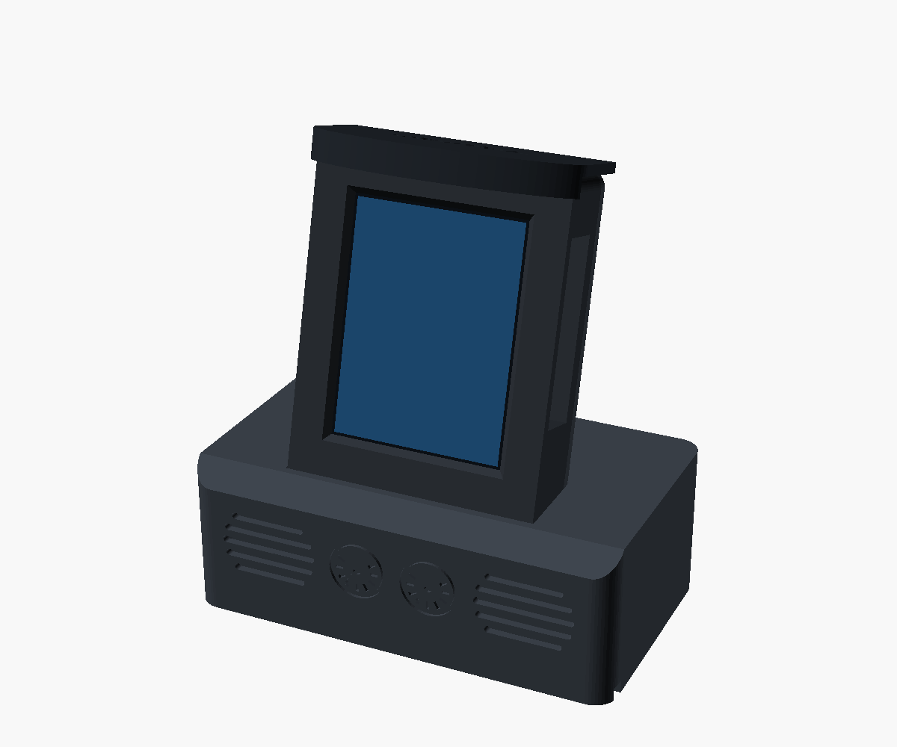

# Cockpit case: Waveshare ESP32-S3-Touch-LCD-2.8



The screen sits upright in an instrument panel with a glareshield over it, leaning back 15° on a console. The
console's front holds the board's two oval speakers (the 2030s in the box) behind grilles, with two engraved gauges
between them.

**Untested:** the figures come from Waveshare's dimension drawing, not a board in hand. Print `front` and `back` first and
check the fit before printing the rest. Everything is set at the top of `contrail-cockpit.scad`.

## Parts

| File | Prints | Size (mm) |
|---|---|---|
| `stl/contrail-front.stl` | face down | 65 × 88 × 19 |
| `stl/contrail-back.stl` | outside face down, posts up | 65 × 88 × 14 |
| `stl/contrail-hood.stl` | top down, lip up | 69 × 33 × 8 |
| `stl/contrail-base.stl` | on its bottom | 112 × 64 × 40 |

PLA or PETG, 0.2 mm layers, 3 walls, 15% infill, no supports. The holes in the walls (USB, buttons) bridge 14 mm at most.

## You'll also need

- 4 × M2.5 × 8 mm screws: these self-tap into the panel's corners and hold the back cover on.
- 2 short pieces of 1.75 mm filament, to pin the hood on, and some glue for it.
- Hot glue or tape, to keep the speakers in their pockets.
- A USB-C cable. A right-angle plug is the easiest fit.

## Assembly

1. Drop the board into the front shell, glass first. The wide black border on the glass goes at the bottom (the USB-C end).
2. Plug in the speaker lead and run it, with the USB-C cable, out of the slot in the shell's bottom.
3. Screw on the back cover. Its four posts press the board against the bezel, and their pins locate in the board's mounting holes.
4. Glue the hood onto the shell's top, using the filament pins to line it up.
5. Push the speakers into their pockets from under the console, grilles forward, and glue them in. Lay their wires in
   the grooves underneath.
6. Feed the cables down the console's shaft and out of the groove at the back, then press the panel into its socket.

## Check before printing it all

- **Board figures:** `glass_*`, `pcb_*`, `aa_top`, `pcb_back` and `usb_z`.
- **Side slot:** the BOOT, RESET and PWR buttons and the TF card slot (`side_slot`). The model puts these on the
  right-hand side as you face the screen. That's worked out from the drawing, so check it on the board.
- **Speakers:** `spk_w`, `spk_h` and `spk_t`, measured on the speakers themselves.
- **Cover depth:** `cav`, the depth behind the board. It has to clear the plugs on the board's back.

## Rebuilding the STLs

You need OpenSCAD 2025 or later (`brew install --cask openscad@snapshot`):

```bash
for p in front back hood base; do openscad -o stl/contrail-$p.stl -D "part=\"$p\"" --backend=manifold contrail-cockpit.scad; done
```
